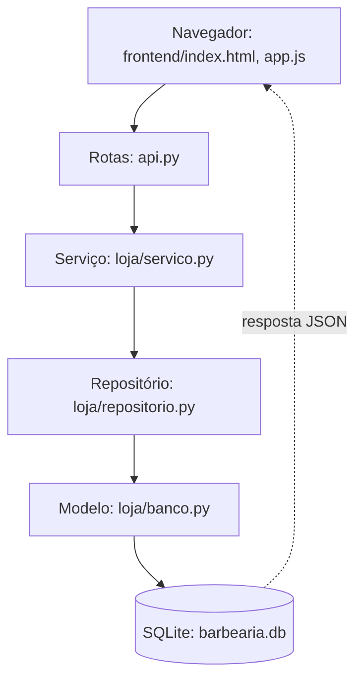

# Barbearia

Agendamento online para barbearia: o cliente escolhe barbeiro, dia e horário, monta a comanda
(corte, barba, sobrancelha), vê o total com desconto e recebe um código de comprovante.

Projeto Final de **Coding: Linguagens e Técnicas** · CST em ADS · Faculdade Senac Pernambuco, unidade Caruaru · 2026.2

**Integrantes:** João Vítor Silva Medeiros, Guilherme José, Ailton Pontes e Luiz Davi.

## Documentação

Tudo em [`docs/`](docs/). Cada diagrama tem a imagem e o arquivo fonte editável (Mermaid).

| Artefato | Imagem | Fonte editável |
|---|---|---|
| Diagrama de domínio | [dominio.png](docs/dominio.png) | [dominio.mmd](docs/dominio.mmd) |
| Modelo ER do banco | [er.png](docs/er.png) | [er.mmd](docs/er.mmd) |
| Diagrama de arquitetura | [arquitetura.png](docs/arquitetura.png) | [arquitetura.mmd](docs/arquitetura.mmd) |
| Relatório técnico (PDF) | [relatorio.pdf](docs/relatorio.pdf) | |

Para editar um diagrama, cole o `.mmd` em <https://mermaid.live> ou rode
`mmdc -i docs/dominio.mmd -o docs/dominio.png -s 2 -b white`.



## Como rodar

Requer Python 3.10 ou superior.

```bash
git clone <LINK-DO-REPOSITORIO> barbearia
cd barbearia/barbeariapronta

python -m venv .venv
.venv\Scripts\activate          # Windows
# source .venv/bin/activate     # Linux e macOS

pip install -r requirements.txt
pytest                          # 11 testes

uvicorn api:app --reload        # API em http://127.0.0.1:8000  (docs em /docs)
```

Em outro terminal, sirva o front-end e abra http://127.0.0.1:5500:

```bash
cd barbearia/barbeariapronta/frontend
python -m http.server 5500
```

Rode o `uvicorn` de dentro de `barbeariapronta/`: o banco `barbearia.db` é criado relativo à pasta atual.

## Estrutura

```
barbeariapronta/
├── api.py              rotas FastAPI
├── loja/
│   ├── dominio.py      Comanda, catálogo, barbeiros, exceções
│   ├── servico.py      regras de negócio (ServicoAgenda)
│   ├── repositorio.py  consultas (RepositorioAgenda)
│   └── banco.py        modelo SQLModel e engine
├── frontend/           index.html, style.css, app.js
├── tests/              11 testes pytest
└── barbearia.db        banco SQLite
docs/                   diagramas e relatório
```
